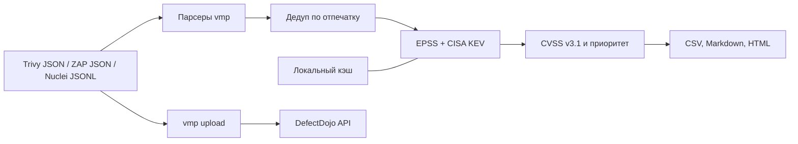
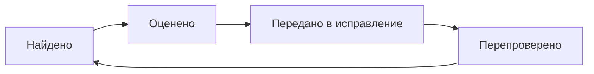

# vmp — конвейер управления уязвимостями

**English.** `vmp` is a small vulnerability-management pipeline aimed at a lab or a first AppSec rotation. It normalizes Trivy, OWASP ZAP, and Nuclei output into one finding model, drops duplicates, attaches EPSS and CISA KEV, recomputes CVSS v3.1, and writes a CSV plus a Markdown/HTML report a developer can act on. An optional command imports the original scanner file into a local DefectDojo. `make demo` runs offline on synthetic fixtures. No secrets and no third-party scan data are in this repository.

Инструмент для инженера, который переходит из DevOps в application security: разобрать отчёты сканеров, убрать дубли, поставить приоритет и отдать очередь на исправление. Это учебный конвейер, а не замена корпоративной VM-платформы.

## Назначение

Сканеры говорят на разных языках. Trivy описывает пакет и CVE, ZAP — URL и параметр, Nuclei — шаблон и `matched-at`. Дальше аналитику всё равно нужны одни и те же ответы:

- это одна и та же находка или две;
- какой у неё базовый CVSS v3.1, если вектор есть;
- есть ли вероятность эксплуатации по EPSS и факт эксплуатации по каталогу CISA KEV;
- что отдать разработчику первым.

`vmp` закрывает этот кусок между сканом и тикетом. DefectDojo остаётся системой учёта: туда уходит исходный файл сканера, а не наша внутренняя модель.

## Архитектура



Пакет `vmp` (Python 3.11+):

| Модуль | Роль |
| --- | --- |
| `parsers.py` | Trivy JSON, классический ZAP JSON (`site[].alerts[]`), Nuclei JSONL |
| `dedup.py` | Стабильный отпечаток и слияние дублей |
| `enrich.py` | FIRST EPSS и каталог CISA KEV, кэш, мягкий отказ сети |
| `scoring.py` | Пересчёт CVSS v3.1 библиотекой `cvss` и балл приоритета |
| `report.py` | `findings.csv`, `report.md`, `report.html` |
| `defectdojo.py` | `POST /api/v2/import-scan/` и `reimport-scan` |

## Жизненный цикл



1. **Найдено.** Сканер отрабатывает по своему стенду (локальный образ, Juice Shop на `127.0.0.1`). На вход `vmp ingest` попадают JSON/JSONL.
2. **Оценено.** Парсер приводит находку к одной модели, дедуп схлопывает повторы, CVSS считается из вектора, EPSS и KEV дополняют контекст, на выходе балл и полоса приоритета.
3. **Передано в исправление.** CSV и HTML/Markdown — для разработчика. `vmp upload` кладёт исходный отчёт в продукт и engagement DefectDojo, чтобы у находки появился хозяин.
4. **Перепроверено.** После исправления скан гоняется снова. `vmp upload --reimport` отправляет новый файл на `reimport-scan` с `close_old_findings=true`: то, чего в новом отчёте нет, DefectDojo закрывает. Сам повторный запуск сканера в этот MVP не входит.

## Дедупликация

Отпечаток не содержит имени сканера:

```text
<CVE или CWE или нормализованный заголовок>|<компонент@version или origin URL>|<путь или параметр>
```

Примеры:

```text
CVE-2021-44228|org.apache.logging.log4j:log4j-core@2.14.1|app/WEB-INF/lib/log4j-core-2.14.1.jar
CWE-89|http://127.0.0.1:3000|/rest/products/search?q
```

Значения query-параметров отбрасываются, имена сортируются: два прогона с разным payload на одном параметре — одна находка. Разные пути одного и того же CVE не схлопываются. При слиянии сохраняются все инструменты, максимальная серьёзность, вектор CVSS и более полное описание.

## Формула приоритета

Балл **RPS** (risk priority score) от 0 до 100. Веса лежат в `vmp/scoring.py`:

```text
RPS = 0.45 * CVSS_norm + 0.25 * EPSS_norm + 0.20 * KEV + 0.10 * Exposure
```

| Слагаемое | Нормализация |
| --- | --- |
| CVSS | базовый балл / 10 × 100 |
| EPSS | вероятность FIRST × 100; если балла нет, вклад 0 |
| KEV | 100, если CVE есть в каталоге CISA KEV, иначе 0 |
| Exposure | `internet` 100, `internal` 40, `unknown` 20 |

Если CVE в KEV и сырой балл ниже **80**, он поднимается до 80. Известная эксплуатация не должна тонуть из-за скромного CVSS.

Полосы: **critical** ≥ 80, **high** ≥ 60, **medium** ≥ 40, **low** ≥ 15, **info** ниже 15.

Откуда берётся CVSS, по порядку:

1. вектор v3.0/v3.1 пересчитывается библиотекой `cvss` (голое `AV:N/...` дополняется префиксом `CVSS:3.1/`);
2. иначе балл, который уже посчитал сканер;
3. иначе карта severity: critical 9.5, high 7.5, medium 5.0, low 2.5, info 0.

Полоса сканера и полоса RPS — разные колонки. Сканер говорит, насколько находка «громкая» у него. RPS говорит, в каком порядке её брать в работу, когда рядом есть данные об эксплуатации и о доступности актива.

Почему веса такие. CVSS описывает тяжесть при успешной атаке, поэтому он самый тяжёлый член, но не единственный. EPSS — вероятность эксплуатации в ближайшие 30 дней, она двигает очередь, не подменяя тяжесть. KEV — бинарный факт «это уже эксплуатируют»; у него и вес, и пол 80. Exposure — единственная поправка на среду, которая есть без CMDB: интернет-доступный экземпляр того же CVE выше внутреннего. `unknown` даёт 20, а не 0 и не 100: отсутствие данных об активе не выглядит ни как «безопасно», ни как «торчит в интернет».

Пример из `make demo` (exposure = internet), CVE-2021-44228:

```text
CVSS 10.0 → 100,  EPSS 0.99999 → 99.999,  KEV → 100,  exposure → 100
0.45*100 + 0.25*99.999 + 0.20*100 + 0.10*100 = 100.00  critical
```

Тот же прогон, SQL injection без CVE (CWE-89, CVSS 9.8, сканер сказал high):

```text
0.45*98 + 0.25*0 + 0.20*0 + 0.10*100 = 54.10  medium
```

EPSS и KEV устроены вокруг CVE. У находки без CVE эти два члена нули, и критичный по сканеру баг может встать ниже уже эксплуатируемой библиотеки. Отчёт прямо пишет об этом в поле Note. Низкое место SQL injection в очереди не значит, что её можно отложить: у неё просто нет EPSS.

Пол 80 проверяется отдельным тестом на синтетическом CVE: CVSS 5.0, EPSS 0, KEV, exposure internal даёт сырые 46.5 и итоговые 80.

## Быстрый старт

Нужен Python 3.11+. Сеть нужна один раз, чтобы поставить зависимости. Сам `make demo` ходит только в локальные файлы.

```bash
python3 -m venv .venv
source .venv/bin/activate
make install
make demo
```

Отчёты появятся в `out/demo/`: `findings.csv`, `report.md`, `report.html`.

Полезные команды:

```bash
make lint          # ruff
make test          # pytest
python -m vmp ingest report.json --exposure internal --out-dir out/app
python -m vmp ingest report.json --fail-on high   # exit 1, если есть high или critical
python -m vmp --help
```

Без `--offline` клиент сходит в FIRST и CISA, обновит каталоги в `--cache-dir` (по умолчанию `.vmp-cache/`, каталог в `.gitignore`) и при ошибке сети продолжит со старым кэшем. Свежесть кэша — 24 часа. Демонстрационный кэш лежит в `samples/cache/` и помечен как неполный снимок на 2026-11-24: в нём только CVE из `samples/`.

## Пример вывода

`make demo` на синтетических фикстурах (`samples/trivy.json`, `samples/zap.json`, `samples/nuclei.jsonl`), exposure = internet, офлайн:

```text
warning: KEV cache is a partial snapshot. CVEs absent from it are treated as not listed.
parsed 12 findings, 10 after deduplication (exposure=internet, offline=True)
enrichment: EPSS known on 7 findings, KEV listed on 4

rank  score   band      id              asset
1     100.00  critical  CVE-2021-44228  org.apache.logging.log4j:log4j-core@2.14.1
2     99.09   critical  CVE-2021-42013  apache2@2.4.49
3     99.01   critical  CVE-2022-22965  org.springframework:spring-beans@5.3.17
4     88.75   critical  CVE-2021-41773  apache2@2.4.49
5     79.08   high      CVE-2022-42889  org.apache.commons:commons-text@1.9
6     69.18   high      CVE-2023-38545  curl@8.3.0
7     54.10   medium    CWE-89          http://127.0.0.1:3000/rest/products/search?q=1
8     35.55   low       CVE-2024-0727   libssl3@3.2.0
9     21.25   low       CWE-693         http://127.0.0.1:3000
10    10.00   info      CWE-200         http://127.0.0.1:3000/
```

Два отчёта Log4j по одному и тому же jar схлопнулись в одну строку (`duplicate_count=2`). SQL injection из ZAP и Nuclei на одном параметре `q` тоже одна строка, инструменты `nuclei,zap`. CVE-2021-41773 и CVE-2021-42013 на одном `apache2@2.4.49` остались разными: это разные идентификаторы. CVE-2022-42889 высоко в очереди из-за EPSS, хотя в приложенном снимке KEV его нет. CVE-2024-0727 при CVSS 5.5 и низком EPSS оказывается ниже веб-находки без CVE.

Фрагмент `report.md` по первой строке: CVSS 10.00 из вектора, EPSS 0.99999, KEV «Apache Log4j2 Remote Code Execution Vulnerability», рекомендация обновить `log4j-core` 2.14.1 до 2.17.1 или новее.

## DefectDojo

Локальный стенд — официальные образы DefectDojo **3.5.300** (django и nginx), Postgres 18.6-alpine и Valkey 9.1.2-alpine с теми digest, что в upstream compose этого тега. Файл `docker-compose.yml` не собирает образы из Dockerfile и не содержит паролей по умолчанию.

| Порт на хосте | Куда | Зачем |
| --- | --- | --- |
| `8080` (`DD_PORT`) | nginx:8080 | UI и API, база `http://localhost:8080`, API `http://localhost:8080/api/v2/` |
| `8443` (`DD_TLS_PORT`) | nginx:8443 | HTTPS |

Postgres и Valkey наружу не проброшены.

```bash
cp .env.example .env
# заменить каждое значение change-me
#   openssl rand -hex 24          # пароль БД, secret key, пароль admin
#   openssl rand -hex 16          # DD_CREDENTIAL_AES_256_KEY, 32 hex-символа
make defectdojo
docker compose logs -f initializer   # дождаться exit 0
```

`make defectdojo` не стартует, пока в `.env` остались плейсхолдеры `change-me`. Файл `.env` в git не попадает.

Как получить API-ключ:

1. Открыть `http://localhost:8080` и войти под `DD_ADMIN_USER` / `DD_ADMIN_PASSWORD` из `.env`.
2. Меню пользователя в правом верхнем углу → **API Key**. Это статический ключ.
3. Вписать его в `DD_API_TOKEN` в `.env` (не коммитить).

Запасной путь, если ключ в UI не виден. `POST /api/v2/api-token-auth/` с JSON `{"username","password"}` возвращает поле `token`. И ключ из UI, и этот token передаются как `Authorization: Token <значение>`. Пароль в историю общей оболочки лучше не класть.

Загрузка исходного отчёта (переменные из `.env` должны быть в окружении):

```bash
set -a && source .env && set +a
python -m vmp upload samples/trivy.json
python -m vmp upload samples/zap.json --reimport
```

Тип скана определяется по файлу: `Trivy Scan`, `ZAP Scan`, `Nuclei Scan`. Чужое имя парсера DefectDojo можно передать как `--scan-type`. Продукт, тип продукта и engagement берутся из `DD_PRODUCT_NAME`, `DD_PRODUCT_TYPE_NAME`, `DD_ENGAGEMENT_NAME`; при отсутствии контекст создаётся (`auto_create_context=true`). `--reimport` закрывает находки, которых нет в новом файле.

Стенд только для своей машины. Не выставляйте эти порты в интернет и не оставляйте `change-me`.

## Тесты и CI

```bash
make lint
make test
```

Pytest покрывает парсеры, отпечаток и дедуп, пересчёт CVSS, пол KEV, офлайн-кэш, отказ сети с сохранением устаревшего кэша, CSV (формулы Excel экранируются) и форму запроса в DefectDojo без реального сервера.

GitHub Actions (`.github/workflows/ci.yml`), версии действий прибиты к полному SHA:

- `lint-and-test` на Python 3.11: ruff и pytest, право только `contents: read`;
- `security`: gitleaks-action v3 и Trivy fs (`scanners: vuln`, порог HIGH/CRITICAL, `ignore-unfixed`, ненулевой exit code). Комментарии и выгрузка артефактов gitleaks выключены. Джобе дополнительно нужно `pull-requests: read`, потому что action читает коммиты pull request. Лицензия gitleaks для персонального репозитория не требуется.

## Ограничения

- Классический JSON ZAP (`site` / `alerts`). Не XML и не новый экспорт automation framework, если в нём нет этого ключа.
- Trivy: блок `Vulnerabilities`. Секреты и misconfigurations из того же JSON не импортируются.
- Дедуп синтаксический. «SQL Injection» и «SQLi» без общего CWE и без одного и того же URL не сольются.
- Нет reachability: уязвимый класс в jar не значит, что приложение его вызывает.
- CVSS environmental (CR/IR/AR, модифицированные метрики) не считается. Exposure — отдельный грубый множитель, один на весь прогон, не из CMDB.
- EPSS и KEV про CVE. У веб-находок без CVE эти сигналы структурно нулевые.
- Офлайн-кэш в `samples/cache/` неполный (`complete: false`) и датирован 2026-11-24. CVE, которого в нём нет, в офлайне не считается KEV. Это снимок публичных каталогов, не живой FIRST/CISA.
- В DefectDojo уходит исходный файл сканера. Наш RPS в продукт сам не записывается.
- Нет Jira, нет SLA, нет подтверждения, что фикс реально выкатили, кроме повторного импорта.
- Образ `vuln-lab:local` и `http://127.0.0.1:3000` в `samples/` — синтетика по публичным CVE и по форме отчётов, а не выгрузка с чужого периметра и не результат сканирования, приложенный к репозиторию как есть.

## Этика

Сканируйте только системы, которыми владеете, или изолированные учебные стенды: свой форк, локальный OWASP Juice Shop, специально собранный уязвимый образ. Этот репозиторий не содержит эксплойтов, учётных данных и чужих сканов. Отчёты описывают, что обновить и какой класс ошибки закрыть (параметризованные запросы, заголовок CSP, патч пакета), и не описывают, как атаковать.

Не направляйте Trivy, ZAP или Nuclei на чужие хосты «для портфолио». Для демонстрации достаточно `make demo`.
